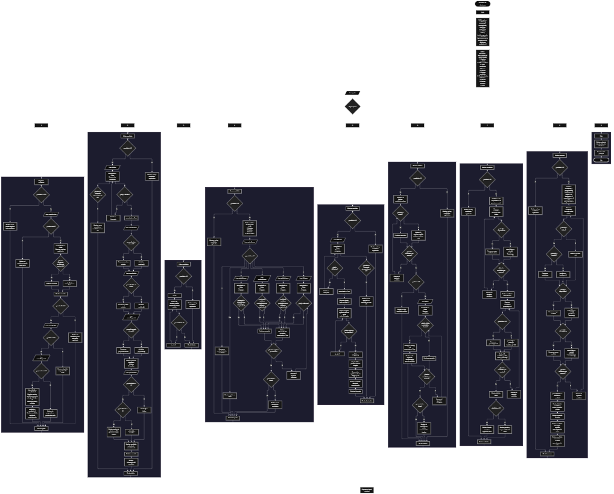

Este proyecto, llamado <b>simulador de elecciones</b>, fue desarrollado en <b>visual basic .net</b> como un ejercicio práctico para fortalecer la lógica de programación mediante la creación de un sistema de administración y simulación de elecciones desde la consola. El programa cuenta con un menú principal de nueve opciones que permite <b>registrar, editar, eliminar, buscar y listar candidatos, simular votaciones, mostrar resultados y consultar un resumen electoral</b>. Cada candidato almacena información como su nombre, partido o movimiento, propuesta principal, cantidad de votos y estado, utilizando arreglos con una capacidad máxima de <b>20 candidatos durante la ejecución</b>. Durante su desarrollo se aplicaron conceptos fundamentales de programación, como variables, arreglos, estructuras condicionales, ciclos repetitivos y estructuras de selección, además de procesos para buscar, modificar, eliminar y reorganizar registros. También se implementaron contadores y operaciones matemáticas para calcular votos, porcentajes, promedios y determinar los candidatos con mayor y menor cantidad de votos.

<h2 align="center">⚙️ Funcionamiento del menú principal</h2>

### ➕ Registrar candidato

La opción <b>1) registrar candidato</b> permite agregar un nuevo candidato al simulador de elecciones. Antes de realizar el registro, el programa comprueba que la cantidad de candidatos almacenados sea menor a <b>20</b>, utilizando la condición <b>cantidad &lt; 20</b>. Si existe espacio disponible, solicita el <b>nombre, partido o movimiento y propuesta principal</b> del candidato. Cada dato debe ser diferente de una cadena vacía. Además, utiliza un ciclo <b>For</b> para comprobar que el nombre no se encuentre registrado previamente, realizando la comparación mediante <b>ToLower()</b> para evitar duplicados que solamente se diferencien por mayúsculas o minúsculas. Si las validaciones son correctas, asigna un identificador consecutivo mediante <b>cantidad + 1</b>, almacena los datos en sus respectivos arreglos, inicializa los votos en <b>0</b> y establece el estado como <b>"Activo"</b>. Finalmente, aumenta la variable <b>cantidad</b> y muestra el mensaje <b>"candidato registrado correctamente."</b>. Si se alcanza la capacidad máxima, informa que no se pueden registrar más candidatos.

### ✏️ Editar candidato

La opción <b>2) editar candidato</b> permite modificar la información de un candidato registrado mediante su identificador. Primero, el programa comprueba si existen candidatos almacenados utilizando la variable <b>cantidad</b>. Si no hay registros, muestra el mensaje <b>"no hay candidatos registrados."</b>. En caso contrario, solicita el ID del candidato y utiliza un ciclo <b>For</b> para localizarlo mediante la comparación <b>ids(i) = idEditar</b>. Cuando encuentra una coincidencia, permite actualizar el <b>nombre, partido o movimiento y propuesta</b>. Cada campo solamente se modifica si el usuario introduce un valor diferente de una cadena vacía; de lo contrario, conserva la información anterior. Después, presenta un pequeño menú para seleccionar el nuevo estado del candidato: <b>1) activo</b> o <b>2) inactivo</b>. Si se introduce una opción diferente, muestra un mensaje de advertencia y mantiene el estado anterior. Finalmente, presenta el mensaje <b>"candidato actualizado correctamente."</b>. Si el identificador no corresponde a ningún registro, informa que no se encontró un candidato con ese ID.

### 📋 Listar candidatos

La opción <b>3) listar candidatos</b> permite visualizar todos los candidatos registrados en el simulador. Primero, el programa comprueba si la variable <b>cantidad</b> es igual a <b>0</b>. Si no existen registros, muestra el mensaje <b>"no hay candidatos registrados."</b>. En caso contrario, utiliza un ciclo <b>For</b> para recorrer los arreglos desde la primera posición hasta la cantidad actual de candidatos. Durante el recorrido, muestra el <b>ID, nombre, partido, propuesta, cantidad de votos y estado</b> de cada candidato. Esta función facilita consultar la información almacenada y conocer la situación actual de los participantes de la elección.

### 🔎 Buscar candidato

La opción <b>4) buscar candidato</b> permite localizar candidatos mediante diferentes criterios de búsqueda. Primero, el programa comprueba que existan registros y después presenta un submenú con cinco alternativas: <b>buscar por ID, buscar por nombre, buscar por partido, buscar por estado y buscar todos</b>. Para las búsquedas individuales, utiliza ciclos <b>For</b> y la variable lógica <b>encontrado</b>, que comienza con el valor <b>False</b> y cambia a <b>True</b> cuando se localiza una coincidencia. La búsqueda por ID realiza una comparación exacta, mientras que las búsquedas por nombre y partido utilizan <b>ToLower().Contains()</b>, permitiendo encontrar coincidencias parciales sin distinguir mayúsculas y minúsculas. La búsqueda por estado compara el texto introducido con el estado almacenado mediante <b>ToLower()</b>. Cuando encuentra candidatos, muestra su información completa. Si no existen coincidencias, presenta el mensaje correspondiente. La quinta alternativa recorre y muestra todos los candidatos registrados.

### 🗑️ Eliminar candidato

La opción <b>5) eliminar candidato</b> permite eliminar un registro mediante su identificador. Antes de comenzar, el programa comprueba que existan candidatos registrados. Si no hay información almacenada, muestra el mensaje <b>"no hay candidatos registrados."</b>. En caso contrario, solicita el ID del candidato y utiliza un ciclo <b>For</b> para localizarlo. Cuando encuentra una coincidencia, establece la variable <b>encontrado</b> en <b>True</b> e inicia el proceso de eliminación. Para mantener organizados los registros, utiliza un segundo ciclo <b>For</b>, controlado por la variable <b>j</b>, que desplaza una posición hacia atrás los datos de los arreglos <b>ids, nombres, partidos, propuestas, votos y estados</b>. Posteriormente, disminuye la variable <b>cantidad</b> en uno y limpia la última posición ocupada de los seis arreglos. Finalmente, utiliza otro ciclo para asignar nuevamente identificadores consecutivos desde <b>1</b> hasta la cantidad actual de candidatos. Después, muestra el mensaje <b>"candidato eliminado correctamente."</b>. Si el ID no corresponde a ningún registro, informa que no se encontró un candidato con ese identificador.

### 🗳️ Simular votación

La opción <b>6) simular votación</b> permite registrar votos para los candidatos que se encuentran en estado activo. Primero, el programa comprueba si existen candidatos registrados. Si no hay registros, muestra el mensaje <b>"no hay candidatos registrados."</b>. En caso contrario, recorre los arreglos y muestra únicamente los candidatos cuyo estado sea <b>"Activo"</b>, utilizando la variable <b>activos</b> para contar cuántos participantes pueden recibir votos. Si no existen candidatos activos, presenta el mensaje <b>"no hay candidatos activos."</b>. Cuando hay candidatos disponibles, solicita el ID del participante al que se desea asignar un voto. Después, utiliza un ciclo <b>For</b> para comprobar que el identificador corresponda a un candidato activo mediante la condición <b>ids(i) = idVoto And estados(i) = "Activo"</b>. Si encuentra una coincidencia, incrementa el contador de votos del candidato mediante <b>votos(i) += 1</b> y muestra el mensaje <b>"voto registrado correctamente"</b>, acompañado del nombre del candidato. Si el ID no existe o el candidato se encuentra inactivo, informa que no es posible registrar el voto.

### 📊 Mostrar resultados

La opción <b>7) mostrar resultados</b> permite consultar los resultados obtenidos durante la simulación electoral. Primero, comprueba que existan candidatos registrados. Si la lista está vacía, muestra el mensaje <b>"no hay candidatos registrados."</b>. En caso contrario, inicializa las variables <b>totalVotos</b>, <b>mayorVotos</b> y <b>ganador</b> para calcular los resultados. Mediante un ciclo <b>For</b>, recorre los candidatos, acumula sus votos en <b>totalVotos</b> y compara las cantidades para identificar al candidato con mayor número de votos. Después, realiza otro recorrido para calcular el porcentaje correspondiente a cada participante mediante la operación <b>(votos(i) / totalVotos) * 100</b>, siempre que el total de votos sea mayor que cero. Los resultados muestran el <b>ID, nombre del candidato, partido, votos y porcentaje</b> de cada participante. Finalmente, presenta el total de votos y, si existen votos registrados, muestra el nombre del ganador y la mayor cantidad de votos. Si todavía no se han registrado votos, informa que aún no existen resultados electorales.

### 📄 Mostrar resumen

La opción <b>8) mostrar resumen</b> permite consultar una estadística general de la elección. Primero, comprueba que existan candidatos registrados. Si no hay registros, muestra el mensaje <b>"no hay candidatos registrados."</b>. En caso contrario, inicializa diferentes variables acumuladoras y contadoras: <b>totalVotos, activos, inactivos, mayorVotos, menorVotos, ganador y candidatoMenor</b>. Después, utiliza un ciclo <b>For</b> para recorrer todos los candidatos, acumular sus votos, contar los participantes activos e inactivos y comparar sus cantidades de votos para identificar al candidato con mayor y menor puntuación. Al finalizar el recorrido, calcula el promedio de votos por candidato mediante la operación <b>totalVotos / cantidad</b>. Finalmente, presenta el total de candidatos, candidatos activos, candidatos inactivos, total de votos, promedio de votos y los nombres y cantidades de votos correspondientes al candidato con mayor y menor resultado. Esta opción permite obtener una visión general del estado de la elección y de la participación de los candidatos.

### 🚪 Salir del menú principal

La opción <b>9) salir</b> permite finalizar la ejecución del simulador de elecciones. Cuando el usuario selecciona esta alternativa, el programa muestra el mensaje <b>"saliendo del simulador de elecciones..."</b>. El menú principal se encuentra dentro de una estructura repetitiva <b>Do ... Loop While</b>, que mantiene el programa en funcionamiento mientras la variable <b>opcion</b> sea diferente de <b>9</b>. Cuando se selecciona esta opción, la condición del ciclo deja de cumplirse y el programa termina su ejecución.

<h2 align="center">🧠 Temas aplicados en el proyecto</h2>

### 📦 Variables

En este proyecto se utilizan variables para almacenar las opciones seleccionadas en los menús, controlar la cantidad de candidatos registrados, identificar los registros que se desean modificar o eliminar, contabilizar los votos y calcular los resultados electorales. También se utilizan variables lógicas para controlar las búsquedas y comprobar si se ha encontrado un candidato. Cada variable cumple una función específica dentro de las operaciones del simulador.

🔢 **Opcion:** Almacena la opción seleccionada por el usuario en el menú principal.

📊 **Cantidad:** Controla el número actual de candidatos registrados.

🔄 **I:** Funciona como contador para recorrer los arreglos y acceder a los registros.

🔁 **J:** Controla el desplazamiento de los datos durante la eliminación de un candidato y la reorganización de los identificadores.

🔎 **IdEditar:** Almacena el identificador del candidato que se desea modificar.

🔎 **IdBuscar:** Almacena el identificador utilizado para realizar una búsqueda.

🗑️ **IdEliminar:** Almacena el identificador del candidato que se desea eliminar.

🗳️ **IdVoto:** Almacena el identificador del candidato al que se desea asignar un voto.

✅ **Encontrado:** Variable lógica que indica si un candidato fue localizado durante una búsqueda, edición, eliminación o votación.

📝 **NombreExiste:** Variable lógica que permite comprobar si el nombre de un candidato ya se encuentra registrado.

📊 **TotalVotos:** Acumula la cantidad de votos registrados entre todos los candidatos.

🏆 **MayorVotos:** Almacena la mayor cantidad de votos encontrada durante el recorrido.

📉 **MenorVotos:** Almacena la menor cantidad de votos encontrada durante el recorrido.

🏅 **Ganador:** Guarda el nombre del candidato que tiene la mayor cantidad de votos.

📊 **PromedioVotos:** Almacena el promedio de votos por candidato.

### 🗃️ Arreglos

En este proyecto se utilizan seis arreglos paralelos para almacenar la información de los candidatos. Cada arreglo tiene una capacidad de <b>20 posiciones</b> y utiliza el mismo índice para representar los datos correspondientes a un mismo participante. Por ejemplo, la información del candidato ubicado en la posición <b>0</b> se encuentra distribuida entre <b>ids[0], nombres[0], partidos[0], propuestas[0], votos[0] y estados[0]</b>. Esta organización permite registrar, consultar, modificar, eliminar y reorganizar los candidatos, además de actualizar sus votos y estados durante la ejecución del programa.

🆔 **Ids[20]:** Almacena los identificadores consecutivos asignados a los candidatos.

📝 **Nombres[20]:** Guarda los nombres de los candidatos registrados.

🏛️ **Partidos[20]:** Almacena los partidos o movimientos políticos a los que pertenecen los candidatos.

📄 **Propuestas[20]:** Guarda las propuestas principales de cada candidato.

🗳️ **Votos[20]:** Almacena la cantidad de votos recibidos por cada candidato.

📌 **Estados[20]:** Identifica si cada candidato se encuentra activo o inactivo.

### 🔀 Estructuras condicionales

En este proyecto se utilizan las estructuras <b>If, ElseIf y Else</b> para comprobar las condiciones necesarias en cada operación. Estas estructuras permiten verificar si existe espacio para registrar candidatos, comprobar que los campos no estén vacíos, evitar nombres duplicados, determinar si un candidato existe, controlar sus estados y validar si puede recibir votos. También se utilizan para comprobar si existen resultados electorales y determinar cuándo deben calcularse los porcentajes, identificar al ganador y mostrar los mensajes correspondientes según las condiciones encontradas.

### 🔄 Estructuras repetitivas

En este proyecto se utilizan las estructuras repetitivas <b>Do ... Loop While</b> y <b>For</b>. El ciclo <b>Do ... Loop While</b> mantiene activo el menú principal hasta que el usuario selecciona la opción <b>9</b>. Los ciclos <b>For</b> permiten recorrer los arreglos para registrar y comprobar nombres duplicados, buscar candidatos, mostrar información, contabilizar votos, calcular resultados y generar estadísticas. También se utilizan ciclos para desplazar los datos de los arreglos durante la eliminación de un candidato y reorganizar sus identificadores.

### 🎯 Estructura según

El programa utiliza la estructura <b>Select Case</b> para evaluar el valor almacenado en la variable <b>opcion</b> y ejecutar la operación correspondiente del menú principal. Cada caso representa una función específica: <b>registrar, editar, listar, buscar, eliminar, simular votación, mostrar resultados, mostrar resumen y salir</b>. También se utiliza la estructura <b>Else</b> para mostrar el mensaje <b>"opcion no valida."</b> cuando el usuario introduce un número que no corresponde a las alternativas disponibles. De esta manera, el programa organiza las operaciones y facilita la navegación entre las diferentes funciones del simulador.

### 🔢 Dimensionamiento de arreglos

El programa utiliza la declaración de arreglos con índices desde <b>0 hasta 19</b>, lo que proporciona una capacidad total de <b>20 posiciones</b> para cada uno de los seis arreglos. La variable <b>cantidad</b> controla cuántas posiciones contienen candidatos registrados y permite limitar los recorridos a los registros existentes. Antes de agregar un nuevo candidato, el programa comprueba que la cantidad actual sea menor que <b>20</b>, evitando superar la capacidad establecida.

### 🔄 Reorganización de registros

Cuando se elimina un candidato, el programa utiliza un ciclo <b>For</b> para desplazar los datos de los registros posteriores una posición hacia atrás en los seis arreglos: <b>ids, nombres, partidos, propuestas, votos y estados</b>. Después, disminuye la variable <b>cantidad</b> en uno y limpia la última posición que anteriormente estaba ocupada. Finalmente, utiliza otro ciclo para asignar nuevamente los identificadores desde <b>1</b> hasta el total de candidatos restantes. Este procedimiento permite mantener los registros organizados y evitar espacios vacíos entre los candidatos almacenados.

### 🧮 Operaciones matemáticas y estadísticas

El proyecto incorpora operaciones matemáticas para procesar los resultados de la simulación electoral. Se utiliza la suma para acumular los votos de todos los candidatos, la división para calcular el promedio de votos por participante y la multiplicación por cien para obtener los porcentajes de participación electoral. También se realizan comparaciones numéricas para identificar las cantidades máxima y mínima de votos. Los resultados decimales se presentan utilizando el formato <b>F2</b>, que muestra dos cifras después del punto decimal.

<h2 align="center">¿Cómo se implementaron las operaciones crud en el proyecto?</h2>

Las operaciones <b>crud</b> se implementaron mediante las opciones del menú principal, permitiendo administrar la información de los candidatos registrados. La operación <b>crear</b> corresponde a <b>registrar candidato</b>, donde se almacenan los datos de un nuevo participante; <b>leer</b> se realiza mediante las opciones <b>listar candidatos y buscar candidato</b>, que permiten consultar los registros existentes; <b>actualizar</b> corresponde a <b>editar candidato</b>, donde se modifican los datos y el estado de un participante; y <b>eliminar</b> se realiza mediante la opción <b>eliminar candidato</b>, que retira un registro y reorganiza los arreglos. Además de estas operaciones, el proyecto incorpora funciones adicionales para simular votaciones, mostrar resultados y generar estadísticas electorales. Toda la información se almacena temporalmente en los arreglos durante la ejecución del programa.

<h2 align="center">Diagrama de flujo del proyecto</h2>

<h2 align="center">🛡️ Validaciones del programa</h2>

### 📭 No existen candidatos registrados

Esta validación se utiliza en las opciones de <b>editar, listar, buscar, eliminar, simular votación, mostrar resultados y mostrar resumen</b>. El programa comprueba si la variable <b>cantidad</b> es igual a <b>0</b>. Si no existen candidatos registrados, muestra el mensaje <b>"no hay candidatos registrados."</b> y evita continuar con las operaciones que necesitan información almacenada.

### ⚠️ Capacidad máxima de candidatos

Esta validación se utiliza durante el registro de nuevos candidatos para controlar la capacidad máxima de los arreglos. El programa comprueba si <b>cantidad &gt;= 20</b> antes de permitir agregar un nuevo participante. Si se alcanza el límite establecido, muestra el mensaje <b>"no se pueden registrar mas candidatos."</b> e impide realizar otro registro hasta que se elimine un candidato.

### 📝 Campos obligatorios vacíos

Durante el registro, el programa comprueba que el nombre, el partido o movimiento y la propuesta principal sean diferentes de una cadena vacía. Si alguno de estos datos está vacío, muestra el mensaje correspondiente: <b>"el nombre no puede estar vacio."</b>, <b>"el partido no puede estar vacio."</b> o <b>"la propuesta no puede estar vacia."</b>. Esta comprobación evita almacenar candidatos sin los datos obligatorios. Sin embargo, el programa no elimina espacios en blanco, por lo que una entrada compuesta únicamente por espacios puede ser aceptada.

### 🔁 Candidatos duplicados

Esta validación se utiliza durante el registro de nuevos candidatos. El programa recorre el arreglo <b>nombres</b> y compara cada nombre almacenado con el nombre introducido mediante <b>ToLower()</b>. Si encuentra una coincidencia, cambia la variable <b>nombreExiste</b> a <b>True</b> y muestra el mensaje <b>"el candidato ya se encuentra registrado."</b>. La comparación no distingue entre mayúsculas y minúsculas. Esta comprobación solamente se realiza al registrar candidatos, por lo que la edición permite introducir nombres que ya pertenecen a otros registros.

### 🔎 Candidato no encontrado

Esta validación se utiliza en las operaciones de búsqueda, edición y eliminación. El programa emplea la variable lógica <b>encontrado</b>, que comienza con el valor <b>False</b> y cambia a <b>True</b> cuando localiza un candidato que coincide con el identificador o criterio solicitado. Si finaliza el recorrido sin encontrar coincidencias, muestra el mensaje correspondiente, como <b>"no se encontro un candidato con ese ID."</b> o <b>"no se encontraron candidatos."</b>. En las búsquedas por nombre y partido se permiten coincidencias parciales, mientras que la búsqueda por ID compara identificadores exactos.

### 🚫 Candidato inactivo

Esta validación se aplica durante la simulación de votaciones. El programa muestra únicamente los candidatos cuyo estado sea <b>"Activo"</b> y comprueba que el ID introducido corresponda a uno de ellos. Si el candidato no existe o se encuentra inactivo, muestra el mensaje <b>"el candidato no existe o se encuentra inactivo."</b> e impide incrementar su contador de votos.

### ⚠️ Estado no válido

Durante la edición de un candidato, el programa presenta dos alternativas para modificar su estado: <b>1) activo</b> y <b>2) inactivo</b>. Si el usuario introduce un número diferente de estas opciones, muestra el mensaje <b>"opcion de estado no valida."</b> y conserva el estado que tenía anteriormente. Los demás campos modificados durante la edición se mantienen actualizados.

### 🗳️ No existen candidatos activos

Esta validación se utiliza durante la simulación de votaciones. El programa inicializa la variable <b>activos</b> en cero y recorre los candidatos registrados para contar aquellos cuyo estado sea <b>"Activo"</b>. Si el contador permanece en cero, muestra el mensaje <b>"no hay candidatos activos."</b> e impide solicitar un identificador para registrar votos.

### 📊 No existen votos registrados

Esta validación se utiliza al mostrar los resultados electorales. Después de acumular los votos de todos los candidatos, el programa comprueba si <b>totalVotos &gt; 0</b>. Si existen votos, calcula los porcentajes y muestra el ganador y la mayor cantidad de votos. Si el total es cero, mantiene los porcentajes en cero y presenta el mensaje <b>"todavia no se han registrado votos."</b>.

### ⚖️ Identificación de mayor y menor cantidad de votos

Durante la generación de resultados y el resumen electoral, el programa utiliza las variables <b>mayorVotos</b> y <b>menorVotos</b> para comparar las cantidades de votos de cada candidato. En el resumen, estas variables permiten identificar al participante con mayor y menor cantidad de votos. Cuando existen empates, el programa conserva el primer candidato encontrado durante el recorrido, debido a que las comparaciones utilizan los operadores <b>&gt;</b> y <b>&lt;</b>, sin actualizar los nombres cuando las cantidades son iguales.

### 🔢 Opción inválida

La estructura <b>Select Case</b> incluye el bloque <b>Case Else</b>, que muestra el mensaje <b>"opcion no valida."</b> cuando el usuario introduce un número que no corresponde a ninguna de las nueve opciones del menú principal. De esta manera, el programa informa que la selección no es válida y permite continuar utilizando el menú principal.

<h2 align="center">🎯 Objetivo del proyecto</h2>

El objetivo principal de este proyecto es fortalecer la <b>lógica de programación</b> mediante el desarrollo de un simulador de elecciones en <b>visual basic .net</b>. A través de su construcción se busca aplicar los conocimientos adquiridos sobre variables, arreglos, estructuras condicionales, ciclos repetitivos y estructuras de selección, integrándolos para administrar candidatos y simular procesos de votación. Además, permite comprender cómo registrar, consultar, modificar y eliminar información, utilizar contadores y acumuladores, realizar operaciones matemáticas y generar resultados estadísticos a partir de datos almacenados temporalmente en una aplicación de consola.

